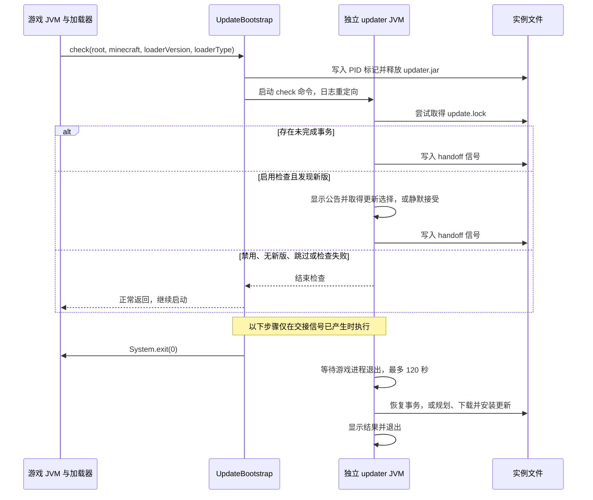
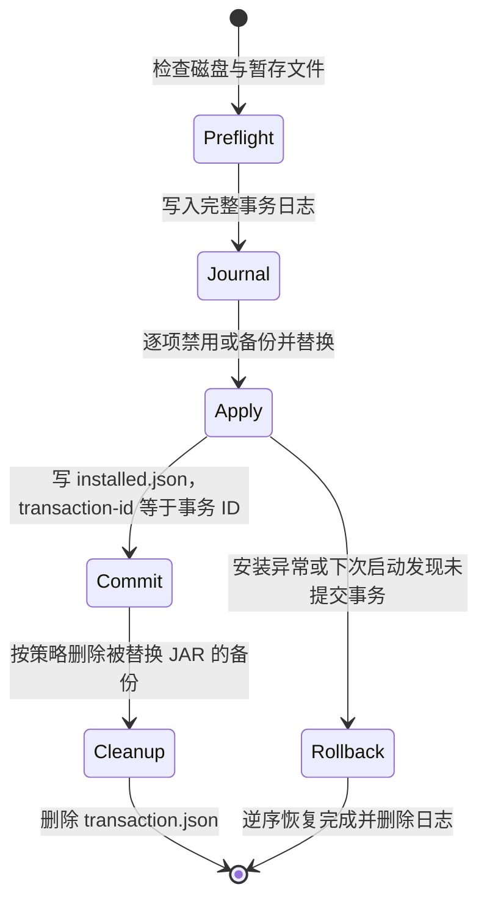

# main 分支实现说明

本文说明 ModpackUpdate `0.3.0-preview.2` 的实际客户端实现，供维护者定位启动检查、差异规划、安装与恢复代码。基准为本地 `main` 的提交 `fb58e0ae638575232931e77f9740fcb8dbb42b07`，整理日期为 2026-11-19。它是该提交的实现快照；后续 `dev` 改动需要另行核对。

项目由加载器适配层、启动桥接器和独立更新器组成。适配层把游戏目录及版本交给桥接器；桥接器启动单独的 JVM；更新器取得玩家同意后通知游戏退出，等待进程结束，再修改整合包文件。成功安装以替换 `installed.json` 为提交点。该提交存在几处路径、基线和失败处理缺陷，见[对应审查报告](review-main-2026-11-19.md)。报告另列出后续 dev 工作区的修复实现；本页保留被审查 main 提交的历史行为。

## 1. 模块与源码职责

| 模块或类 | 具体职责 | 依赖边界 |
| --- | --- | --- |
| `fabric/` | `UpdatePreLaunch.onPreLaunch()` 从 Fabric Loader 读取实例、Minecraft 与加载器版本 | 实现 Fabric `PreLaunchEntrypoint`；元数据限定客户端 |
| `quilt/` | 原生 `pre_launch` 入口，使用 Quilt API 读取版本和目录 | 用 Fabric 兼容 API 检查客户端环境；无需 QSL |
| `forge/` | `UpdateMixinPlugin.onLoad()` 提前检查，模组构造器调用 `checkOnce()` 兜底 | FML、Mixin；`AtomicBoolean` 防止重复检查 |
| `neoforge/` | 与 Forge 相同的入口结构，读取 NeoForge 版本 | 独立的 NeoForge FML、Mixin 依赖 |
| `bootstrap/UpdateBootstrap` | 注册游戏进程标记、释放内嵌 updater、启动子进程、处理退出交接 | 仅使用 JDK API，编译为 Java 17 |
| `updater/Main` | CLI 分派、实例锁、恢复优先、检查与更新编排、`seed` | 独立 JVM 的主入口 |
| `updater/Models` | 配置、发布元数据、基线、目标、变更和事务日志的数据模型 | Gson 使用短横线 JSON 字段名 |
| `updater/Protocol` | 验证发布及索引、合并目标列表、取得所选文件、完整包兜底 | 消费静态 JSON、ZIP 和 `.mrpack` |
| `updater/Downloads` | URL 限制、重定向、超时、大小与 SHA-512 校验、缓存 | JDK `HttpClient` |
| `updater/Planner` | 生成差异与冲突项，计算下一份安装基线 | 不下载、不安装文件 |
| `updater/Installer` | 安装前校验、重复模组 ID 检查、事务日志、备份、安装和恢复 | 文件变更集中在此执行 |
| `updater/ModMetadata` | 根据加载器读取顶层 JAR 的模组 ID | Gson 解析 JSON，NightConfig 解析 TOML |
| `updater/FilesSupport` | 路径检查、保护规则、哈希、JSON 读写和文件替换 | `ATOMIC_MOVE` 不受支持时退化为普通替换 |
| `updater/UpdateUi` | 版本公告、冲突勾选、进度、结果窗口 | 独立 Swing UI，经 EDT 执行界面操作 |

Java 类位于 `dev.modpackupdate.<模块>` 包中；上表中的 updater 类位于 `updater/src/main/java/dev/modpackupdate/updater/`。

每个发布的模组 JAR 包含对应适配层、bootstrap 类，以及资源 `/modpackupdate/updater.jar`。updater 是包含 Gson 与 NightConfig 运行依赖的独立可执行 JAR，适配层不直接加载这些库。

## 2. 启动检查与进程交接



### 2.1 桥接器

`UpdateBootstrap.check()` 先把游戏目录转成真实路径，建立 `ModpackUpdate/runtime/` 与 `runtime/games/`。`games/<PID>` 保存当前 JVM 的启动时间，shutdown hook 删除该标记。PID 与启动时间一起用于区分另一份游戏实例和被复用的进程编号。

桥接器对内嵌 updater 字节计算 SHA-256，以 `runtime/updater-<SHA256>.jar` 作为释放路径。Windows 使用当前 `java.home/bin/javaw.exe`，其他系统使用 `java`，工作目录为实例根目录。标准输出和错误输出合并到 `runtime/check-<UUID>.log`。

桥接器每 100 ms 等待子进程结束，并检查随机的 `handoff-<UUID>` 文件。发现该文件后删除信号并调用 `System.exit(0)`。子进程结束码为 `20` 时抛出异常阻止游戏启动；其他结束码和捕获到的普通异常会放行。该策略对存在未完成事务的异常场景有缺口，见审查报告 R3。

当前缓存释放仅检查目标文件是否存在，没有复核缓存本身的 SHA-256，见 R5。

### 2.2 独立更新器

`Main.check()` 使用 `FileChannel.tryLock()` 锁住 `ModpackUpdate/update.lock`。该锁覆盖检查、玩家选择、下载、安装以及结果窗口的整个生命周期。

`Main.checkLocked()` 的执行顺序为：

1. 校验 handoff 路径必须直接位于实例的 `ModpackUpdate/runtime/` 下，文件名以 `handoff-` 开头。
2. 检查其他游戏标记。另一份游戏仍在运行时跳过普通检查；若同时有未完成事务，则返回 `20`。
3. 优先处理 `transaction.json`。先交接并等待父游戏进程退出，再执行恢复。因此 `enable: false` 也不会跳过正常可执行的事务恢复。
4. 生成或读取配置。默认 `enable: false`；启用时读取并校验 `installed.json`。
5. 下载发布元数据；仅在远程 `release-id` 大于本地记录时提示新版。非静默模式允许在此跳过并继续游戏。
6. 写交接信号，等待父进程退出。随后才取得索引、检查版本、规划差异和显示安装选择。
7. 下载选中文件，计算下一份基线，执行事务安装，显示结果。

`handoff()` 使用 `ProcessHandle.onExit().get(120, SECONDS)` 等待父进程。超时或其他错误时，不继续安装。

版本判断仅比较发布编号，不做语义版本排序。客户端要求 Minecraft、加载器类型及加载器版本精确匹配，不安装或切换游戏与加载器。

## 3. 命令、配置与实例目录

### 3.1 CLI

```text
java -jar updater.jar --version
java -jar updater.jar check <instance> <parent-pid> <handoff-path> <minecraft> <loader-version> [loader-type]
java -jar updater.jar seed <instance> <release-url> <pack-id> <minecraft> <loader-version> [loader-type]
```

`check` 由 bootstrap 调用。省略 `loader-type` 时采用 `fabric-loader`；其他可选值为 `neoforge`、`forge`、`quilt-loader`。`--version` 从 JAR manifest 读取版本，非打包环境显示 `development`。

| updater 结束码 | 实际含义 |
| --- | --- |
| `0` | 禁用、无新版、玩家跳过、取消后结束、恢复完成或安装完成 |
| `1` | 普通检查或更新错误，以及外层 `main` 捕获到的异常 |
| `2` | CLI 参数不匹配 |
| `20` | 已有 updater 占用实例，或恢复场景需要阻止游戏继续启动 |

结束码不是完整的事务状态判断；尤其不能由非 `20` 推断实例没有未完成事务。

### 3.2 配置

`FilesSupport.JSON` 使用 Gson 的 `LOWER_CASE_WITH_DASHES` 命名策略，例如 `protectedPaths` 对应 `protected-paths`。配置省略字段时保留 `Models.Config` 的默认值。完整用法见[配置说明](configuration.md)。

| 配置字段 | 默认值 | 实现作用 |
| --- | --- | --- |
| `enable` | `false` | 控制新的远程检查 |
| `update-service-url` | 空字符串 | 发布元数据 URL |
| `pack-id` | 空字符串 | 与发布元数据及非空本地记录精确匹配 |
| `silent-update` | `false` | 跳过初次版本提示；无冲突时也跳过安装确认 |
| `delete-replaced-mods` | `false` | 提交成功后删除同路径被替换 JAR 的备份 |
| `timeout-seconds` | `10` | 下载层限制到 2–120 秒 |
| `protected-paths` | `options.txt`、`optionsof.txt`、`servers.dat`、`saves/`、`screenshots/` | 忽略对应目标和旧模组禁用操作 |

配置中的数组整体替换默认数组。保护匹配忽略大小写，以 `/` 结尾的规则进行目录前缀匹配，其余进行精确字符串匹配。`ModpackUpdate/` 独立保留，不受用户清空数组影响。匹配前没有统一规范化路径，存在 R2 描述的别名问题。

该 main 提交没有 `full-pack-url` 配置。完整包兜底依赖先成功读取发布元数据中的 `full-pack`。

### 3.3 文件布局

```text
<实例根目录>/
  mods/                                  游戏实际加载的 JAR
    old.jar.disable                      已退出目标清单的受管旧模组
  ModpackUpdate/
    config/
      config.json                        作者或玩家配置
      installed.json                     当前版本及受管文件基线
    update.lock                          updater 进程锁
    transaction.json                     未清理的安装事务
    downloads/
      release.json                       本次取得的发布元数据
      <SHA512>                           校验后的文件或压缩包缓存
      <SHA512>.part                      网络下载临时文件
      <SHA512>.extract                   ZIP 提取临时文件
      install-*.tmp                      安装复制临时文件
    runtime/
      updater-<SHA256>.jar                独立更新器
      check-<UUID>.log                    一次启动检查及后续更新的日志
      handoff-<UUID>                     退出交接信号，正常情况下很快删除
      games/<PID>                        游戏进程启动时间标记
    <更新前版本>/<事务 UUID>/
      config/...
      mods/...                           覆盖安装前的原文件备份
```

运行目录位于实际游戏实例根目录，不能按启动器安装目录或全局 `.minecraft` 目录推断。当前没有自动清理历史日志、helper 版本、下载缓存和保留备份的任务。

## 4. 发布协议与目标列表

`Models.Release` 包含 `protocol-version`、`pack-id`、`release-id`、`version`、`announcement`、`index`、`overrides` 和 `full-pack`。`Artifact` 统一表示 URL、SHA-512 和字节大小。发布服务实现不在仓库中；仓库只定义并消费静态产物。

`Protocol.release()` 将元数据下载到 `downloads/release.json`，限制 16 MiB，然后验证：

- 协议版本为 `1`，pack ID 与配置精确匹配。
- 发布编号非负；版本字符串为 1–80 个受限 ASCII 字符，首位为字母或数字。
- 索引和完整包声明存在，大小在 0–20 GiB 内，哈希为 128 位小写十六进制 SHA-512。
- overrides 文件列表存在；声明不存在 archive 时，文件表必须为空。

URL 在实际下载时由下载层验证。元数据没有独立数字签名；配置的更新源决定可信发布内容。

`Protocol.targets()` 优先取得独立索引。取得或校验失败时，从完整 `.mrpack` 中提取 `modrinth.index.json`，仍要求与元数据声明的原索引大小、哈希完全一致。

索引使用 Modrinth `formatVersion: 1`、`game: "minecraft"`。代码验证 `versionId`、Minecraft 和当前加载器依赖，拒绝同时声明另一种已知加载器。标准格式及 overrides 分层规则见 [Modrinth 官方格式](https://support.modrinth.com/en/articles/8802351-modrinth-modpack-format-mrpack)。

| 索引条目 | 处理方式 |
| --- | --- |
| `env` 缺省 | 按客户端 `required` |
| `env.client: unsupported` | 验证路径后跳过，不生成客户端目标 |
| `env.client: optional` | 生成可选目标，由规划层保留既有安装选择 |
| 普通文件 | 读取 `path`、`hashes.sha512`、`fileSize` 和非空 `downloads` 数组 |
| 发布 `overrides.files` | 在索引目标之后写入，相同字符串路径以 override 为准，且设为非可选 |

同一层使用原路径字符串的小写形式检查重复；跨索引和 overrides 层允许完全同名覆盖，拒绝仅大小写不同的名字。当前没有消除重复 `/` 等文件系统别名，也没有将目标路径与旧安装基线统一比较，见 R1、R2。

`Protocol.stage()` 对普通文件依次尝试索引中的下载地址。对 override 先取派生 ZIP 并提取相对路径；失败时改取完整包，优先提取 `client-overrides/<path>`，否则提取 `overrides/<path>`。只提取所选条目，不把整个 ZIP 展开到实例。

完整包能恢复索引和包内 overrides，不能替代外部模组下载链接。发布元数据本身不可达时，本提交的检查直接失败并继续游戏。

## 5. 下载与内容校验

`Downloads` 仅接受 HTTPS，另允许 `http://localhost` 和 `http://127.0.0.1` 调试。拒绝缺少主机、携带用户名密码或 fragment 的 URL。重定向由代码手动处理，最多跟随五次，每一跳重新检查 URL。

网络连接和单次请求使用配置超时。响应体流另设 watchdog：大小不超过 16 MiB 时使用同样秒数，超过时最多读 30 分钟。每次重定向及备用地址尝试各有自己的网络阶段限制。

下载以 128 KiB 缓冲写入 `<hash>.part`，读取过程中限制大小，结束后同时检查实际字节数和 SHA-512，再替换为 `<hash>` 缓存。失败时删除 `.part`。同一 `Downloads` 对象内已验证的缓存再次使用时检查大小并复用验证结果；新会话首次复用会重新计算哈希。

ZIP 提取还检查条目存在、非目录、声明大小一致、同名条目仅一个、实际解压大小及哈希。提取先写 `.extract`，成功后替换缓存，失败时删除临时文件。

## 6. 差异规划与基线推进

### 6.1 基线字段

`installed.json` 的 `files` 是路径到 `Baseline` 的映射。

| 字段 | 含义 |
| --- | --- |
| `sha512` | 最近实际采用的作者内容哈希；首次接管且未覆盖时可以为空 |
| `target-sha512` | 最近处理过的发布目标哈希，包括玩家选择跳过的目标 |
| `retained` | 是否保留本地差异或跳过该次安装 |
| `optional` | 记录该文件的客户端可选属性；同内容属性转换存在 R4 缺陷 |

原始基线来源于发行内容，不能用玩家修改后的磁盘哈希冒充。`Main.validateInstalled()` 检查 schema、pack ID、文件表、路径和哈希格式。

### 6.2 `Planner.plan()`

规划先遍历完整目标列表，再遍历旧基线中消失的受管 JAR。

| 条件 | 结果 |
| --- | --- |
| 保护路径 | 完全跳过 |
| 目标哈希等于旧 `target-sha512`，且不是可选改必需 | 不读磁盘，不产生变更 |
| 当前磁盘内容已等于目标 | 产生无冲突变更，用于接管或刷新基线；无需下载 |
| 当前内容与可信旧 `sha512` 不同，包括文件缺失 | 冲突：本地文件已修改或移除 |
| 没有旧基线，但磁盘存在不同内容 | 冲突：现有文件缺少原版基线 |
| 新目标可选且磁盘不存在 | 冲突：默认不安装，勾选后安装 |
| 旧记录可选、新目标必需且磁盘不存在 | 冲突：此前未安装的可选文件已改为必需 |
| 旧基线中的 `mods/*.jar` 在目标中消失 | 产生禁用操作；本地修改过时需要玩家选择 |
| 清单外用户模组，或消失的非 JAR 文件 | 不删除、不禁用 |

这里是差异更新，不是全量修复或完整性扫描。上游未改变目标哈希时，即使玩家后来修改或移除了文件，也不会仅因此重新处理。现有测试明确覆盖了“不读取内容未变的路径”这一设计。

### 6.3 选择与 `Planner.next()`

冲突项默认不勾选。无需选择的变更自动进入安装集合。非静默模式还显示第二次安装确认；静默模式在没有冲突时直接返回选择结果。有冲突时仍显示 Swing 勾选窗口。

下一份安装记录先复制旧文件表，再按变更推进：选中安装则将两个哈希设为目标、`retained` 设假；选中禁用则删除该基线；跳过安装则保留原 `sha512`、记录新的 `target-sha512` 并设 `retained: true`；跳过禁用则保留旧基线。最后移除保护路径记录。

即使保留部分差异，成功事务仍推进整包 `release-id` 和 `version`。相同发布不会下次再提示。当前 `next()` 只处理 `changes`，没有用完整 `targets` 刷新同哈希文件的属性，这导致 R4。

## 7. 安装前校验与模组 ID

`Installer.install()` 先拒绝已有事务，再构造安装后的活动模组集合。它读取 `mods/` 直接子项中以小写 `.jar` 结尾的文件，应用选中的新增、替换和禁用操作后，检查顶层 JAR 声明的模组 ID 是否重复。

| 加载器 | ID 来源 |
| --- | --- |
| Fabric | `fabric.mod.json` 的 `id` |
| Quilt | 优先 `quilt.mod.json` 中的 `quilt_loader.id`，否则使用 Fabric 元数据 |
| Forge | `META-INF/mods.toml` 的全部 `[[mods]].modId` |
| NeoForge | `META-INF/neoforge.mods.toml` 的全部 `[[mods]].modId` |

每份模组元数据最多读 1 MiB。TOML 使用真正的解析器，不用正则抓取依赖表或注释。没有对应元数据的 JAR 返回空 ID 列表。这是顶层 ID 冲突预检，不执行加载器完整的模组依赖解析，也不递归解析嵌套 JAR。

随后对所有选中项重新计算目标磁盘哈希，必须与规划时的 `observedHash` 一致；需要安装时还重新校验暂存文件的 SHA-512。全部预检通过后才写事务日志。

## 8. 安装事务与恢复

### 8.1 日志与提交点

`Journal` 保存事务 `id`、`backup-directory`、删除旧备份策略及全部 `operations`。每项操作包含目标 `path`、备份相对路径 `backup`、可选 `disabled-path`、`new-hash` 和 `old-hash`。Gson 默认省略空字段。

备份目录由更新前版本和 UUID 组成。版本字符串不符合限制时用 `unknown`。完整操作列表在任何受管目标变更前写入 `transaction.json`。



图中恢复完成以每项文件及哈希检查成功为条件；冲突会保留日志并报错。

### 8.2 实际文件操作

禁用操作将 JAR 改名为 `<path>.disable`。已有该名称时使用 `<path>.<事务 UUID>.disable`，不覆盖已有禁用文件。

替换操作先将原文件移动到备份树，再将已验证的暂存内容复制到 `downloads/install-*.tmp`，最后通过 `FilesSupport.replace()` 放到目标路径。新增文件没有旧备份。

全部操作完成后，把事务 ID 写入 `next.transactionId`，再保存 `installed.json`。这份记录的替换是逻辑提交点。成功后可删除本次替换 JAR 的备份，并删除事务日志；普通配置备份和 `.disable` 文件保留。

JSON 写入使用同目录临时文件、`FileChannel.force(true)` 和替换操作。受管文件复制及目录项没有完整的断电持久化协议，因此不能将进程中断恢复能力等同于所有断电场景的数据持久性保证。

### 8.3 `recover()`

恢复读取事务日志和安装记录：

1. 若 `journal.id == installed.transactionId`，说明安装记录已提交，只执行提交后清理，不回滚文件。
2. 否则逆序遍历操作。禁用文件存在时，校验旧哈希且原位置为空，再移回原路径。
3. 替换目标只允许处于旧哈希、新哈希或缺失状态。存在有效备份时还原备份；原来不存在的新增文件被移除；原来存在却既无旧文件也无备份时报错。
4. 全部成功后删除事务日志。发生外部修改或文件冲突时保留日志，供下一次恢复或人工排查。

原安装异常会立即尝试 `recover()`，恢复异常作为 suppressed exception 附在原异常中。当前没有恢复向导来解决外部修改或 R2 导致的日志矛盾。

## 9. `seed` 的出厂基线生成

`Main.seed()` 要求实例目录存在且没有 `installed.json`，以免覆盖运行实例的差异记录。它取得指定固定发布的元数据和索引，校验目标平台，再从发行目标的哈希生成基线。普通情况下不会下载所有模组；独立索引获取失败时仍可能下载完整包。

命令使用默认保护规则；可选目标仅在打包目录中存在时纳入初始记录。每个纳入的目标把 `sha512` 和 `target-sha512` 设为发行哈希，而非计算玩家当前文件来冒充作者基线。已有 `config.json` 保留；缺失时生成启用更新的配置。打包者必须确保打包实例与对应固定发布一致，并按[打包流程](packaging.md)把配置和记录放入发行 overrides。

## 10. 构建与测试

`build-targets.json` 是目标清单。`settings.gradle` 校验清单并为每个目标建立 `.gradle/target-projects/<id>` 子项目；根 `build.gradle` 复用适配层源码，分配独立 `build/targets/<id>` 输出目录。

| 平台 | Minecraft | 编译和测试加载器 | JDK |
| --- | --- | --- | --- |
| Fabric | 1.20.1 | 0.16.10 | 17 |
| Fabric | 1.21.1、1.21.4 | 0.16.10 | 21 |
| NeoForge | 1.21.1 | 21.1.266 | 21 |
| NeoForge | 1.21.4 | 21.4.161 | 21 |
| Forge | 1.20.1 | 47.4.28 | 17 |
| Quilt | 1.20.1 | 0.30.2 | 17 |
| Quilt | 1.21.1 | 0.30.2 | 21 |

共享 bootstrap 和 updater 编译为 Java 17。适配层按目标选择 JDK 和 class 版本；资源处理展开版本、Minecraft 与加载器范围。JAR 任务嵌入 updater，关闭归档时间戳并固定文件顺序。

`<target>Dist` 构建单个目标，`<platform>Dist` 构建某平台全部目标，`allDist` 构建全部目标；均依赖对应模块的 `build`，包含测试。根 `build` 和 `dist` 都汇总到 `allDist`。`Sync` 将产物同步到 `build/dist/<选择>/`。

CI 从清单产生八个 Linux job，安装 JDK 17 与目标 JDK，在 Xvfb 下执行 Swing 测试，上传产物和报告，不自动发布 Release。详细命令见[构建说明](building.md)。

本次在 Windows、JDK 17/21、Gradle 8.14.3 的固定 main 副本中执行 `allDist --offline`：8 个目标构建成功，原有 59 项测试全部通过，0 跳过。另用[审查复现程序](review/MainReviewProbe.java)复现 5 项缺陷的 6 个场景。这些测试覆盖模拟进程、文件锁与加载器上下文，没有替代真实 Minecraft 和不同启动器的启动验证。

## 11. 维护时必须保持的边界

- 新检查可以在离线时继续游戏；有未完成事务时，应能区分网络不可达和实例状态不安全。R3 是当前实现未满足的部分。
- 所有路径参与保护匹配、基线查找和事务规划时应代表同一文件身份；R1、R2 需要先解决，不能只依靠单个清单中的小写字符串去重。
- `installed.json` 只在整批文件操作成功后推进；玩家跳过的内容也应留下作者基线和最近目标，不能把玩家当前内容认作发行原版。
- 同哈希文件可以避免重复读盘，但 `optional` 等发布属性仍须推进，见 R4。
- 备份删除必须在提交后执行；在修改恢复逻辑时，应覆盖提交前、提交后清理前和恢复再次中断的不同状态。

具体问题、定位、影响和验证输出见[main 分支代码审查](review-main-2026-11-19.md)。
